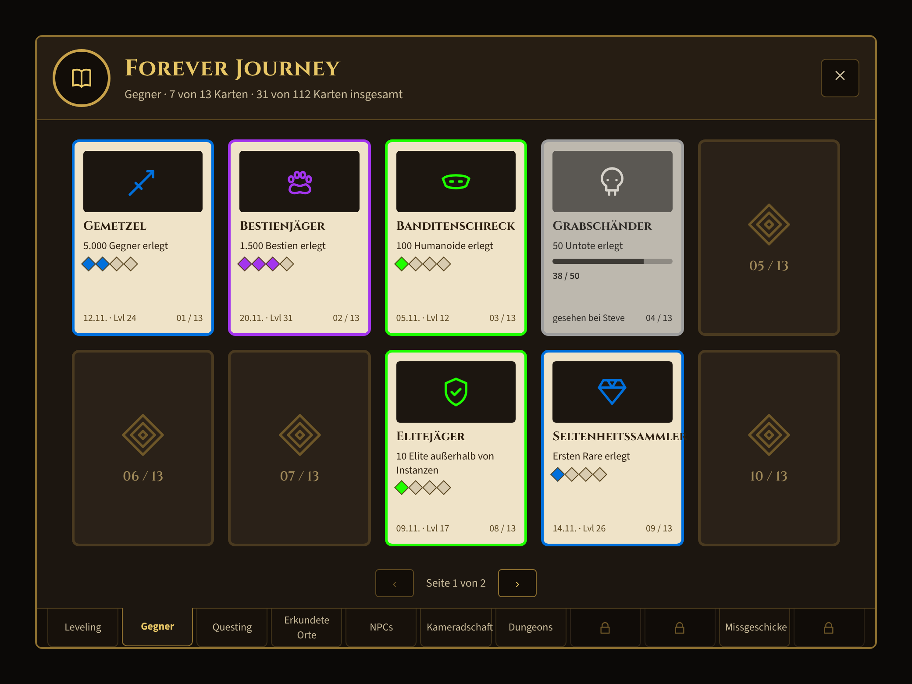
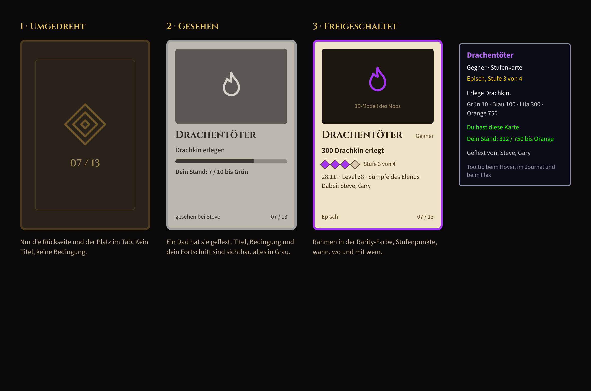
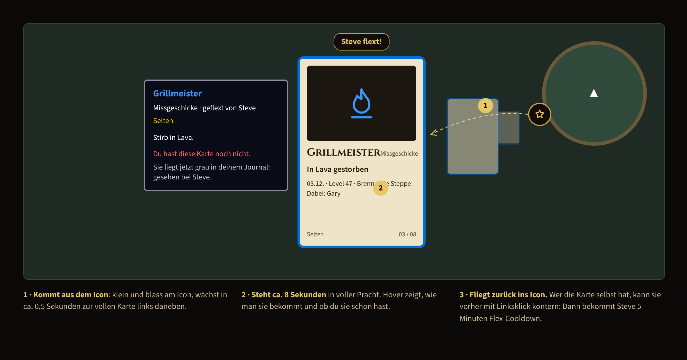
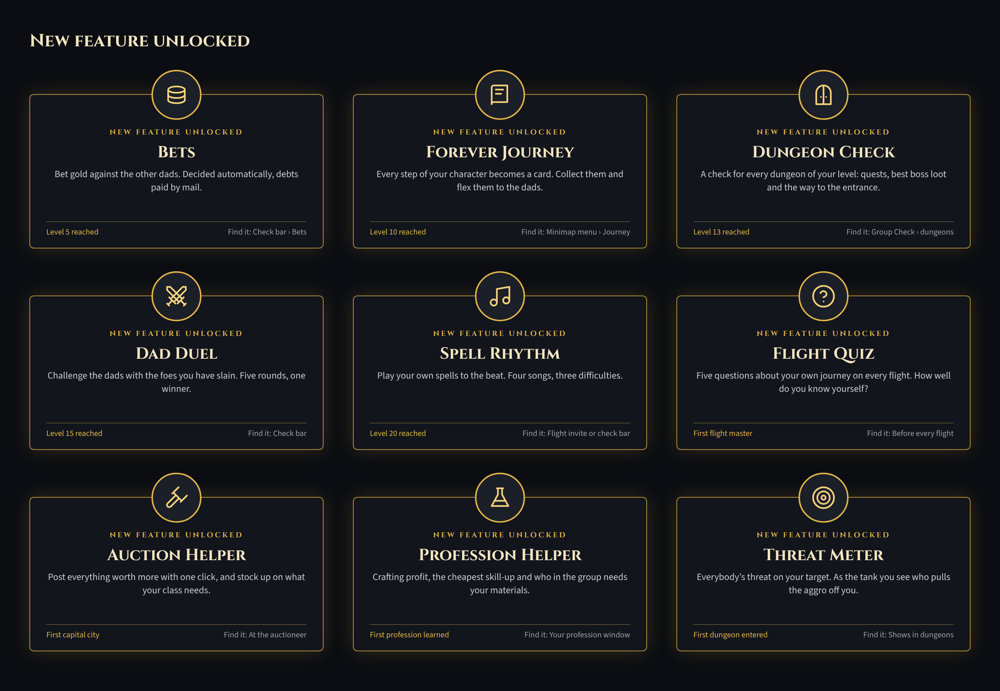
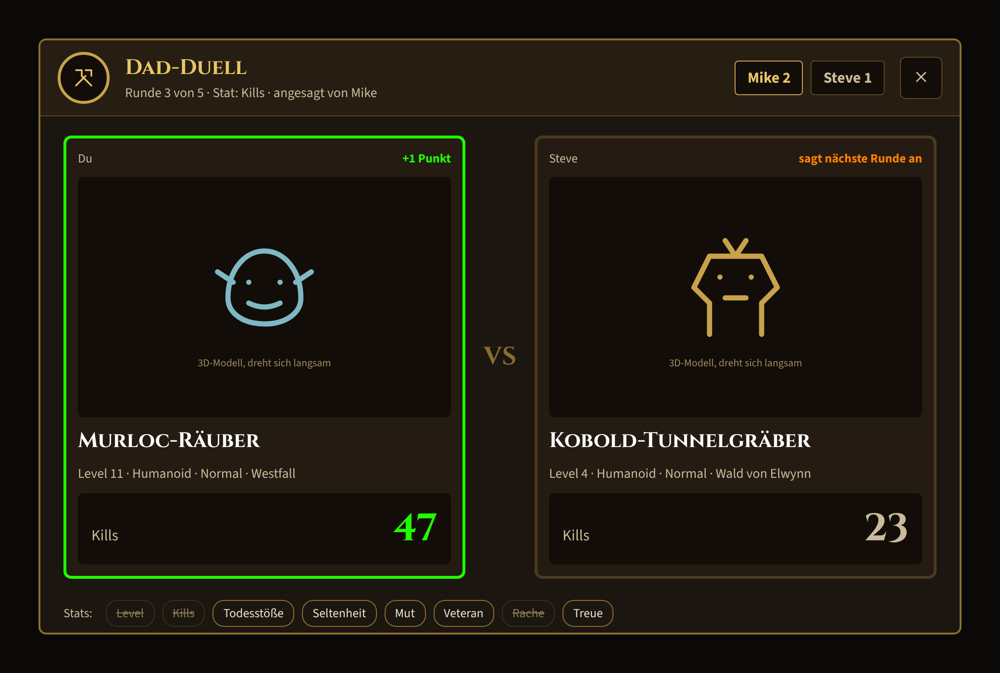
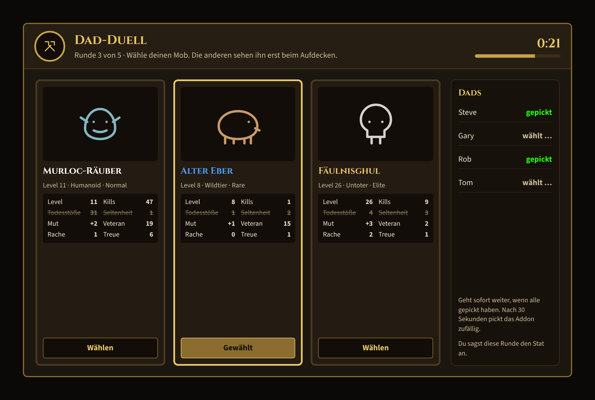
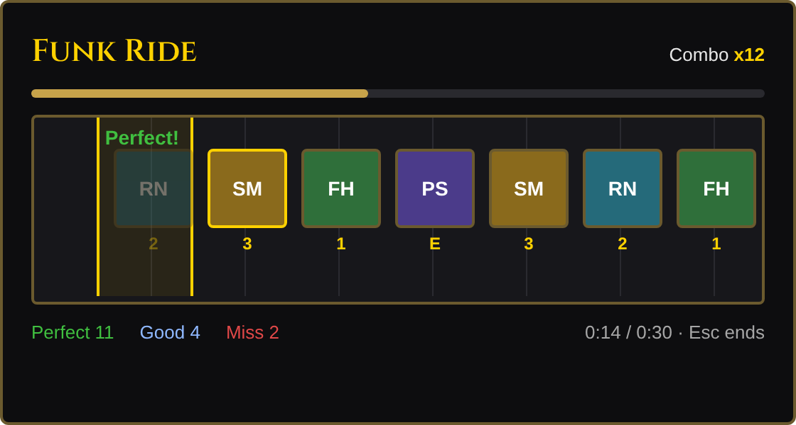
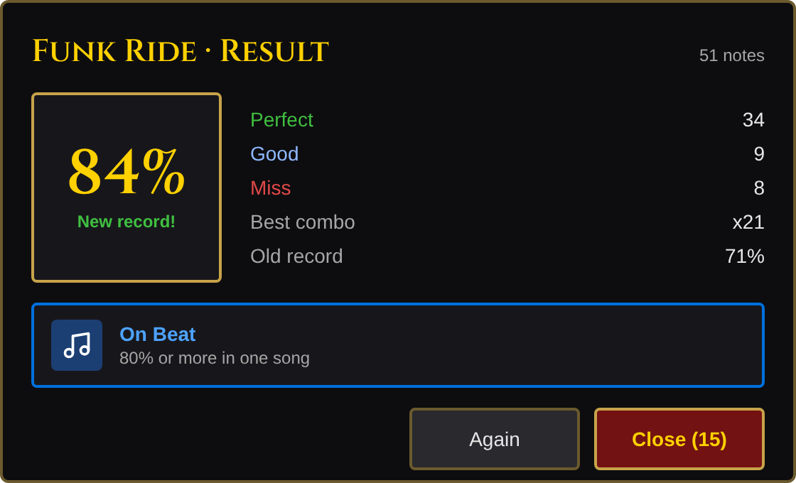
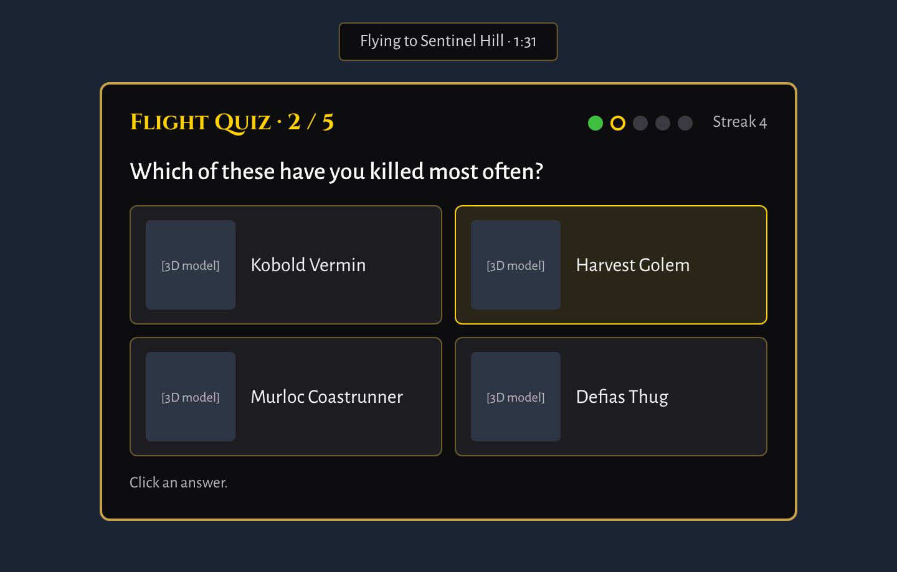
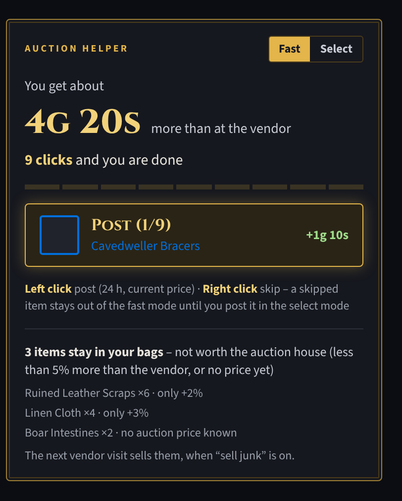

# One More Quest

A World of Warcraft addon for **WoW Forever**, made for a small group of friends (a few dads) who level together and want to reach 60 as a party. It works alone, but most features come alive when everybody in the group runs it.

Works with English and German clients. `/omq features` shows the full list in the game.

## A look at it

Design mockups made while building the addon (some still with German texts); the game windows look close to this.

| | |
|---|---|
|  |  |
| **Forever Journey:** the journal with its tabs and cards | **Journey cards:** face down, seen at another dad, unlocked |
|  |  |
| **Flex:** a dad shows off a card | **Unlocks:** the cards for each new feature |
|  |  |
| **Dad Duel:** reveal, best value wins the round | **Dad Duel:** pick one of your slain foes in secret |
|   |  |
| **Spell Rhythm:** play your spells to the beat | **Flight Quiz:** questions about your own journey |
|  | |
| **Auction Helper:** post everything worth more, one click each | |

## Features

### Playing together
- **One more quest?** `/omq` starts a vote: one more quest or bed time. If it is one more quest, the arrow leads the group to the next quest every dad has (its objectives, or the turn-in once all are done), or to a new one everybody can take. Bed time hands out titles for the session.
- **Group statistics** for the session, ranked between the dads: XP per hour, levels, gold, yards walked and on follow, damage share, killing blows, deaths, near deaths, fights started and more, plus lifetime statistics of every character.
- **Level 60 forecast:** time to level 60 at your own pace and against a reference, as played hours and real days (`/omq lvl60`). `/omq played` shows played time without AFK and capital city time.
- **Quest sharing:** quests are shared and accepted automatically between dads up to 5 levels apart; when the whole group is in one zone, the quests of that zone are shared.
- **Group quest tracker** with every dad's progress on shared quests.
- **Meeting point** and map pin shared with the group; arrow to the nearest dad when you fell behind; follow key for the nearest dad; follow the group's flights.
- **Item score** in every item tooltip, for you and every dad: what each one wears and whether the item is an upgrade for his class and role.
- **Mana break note** when a dad drinks.

### Runs
All runs live in the run bar above the check bar; one run at a time, with a small arrow, a tracker card and markers on the world map.
- **Quest Run:** pick 1, 3, 5 or 7 quests; OMQ plans the shortest way through quest givers and objectives.
- **Area Run:** pick a zone; OMQ plans one way through all its quests and their follow-ups (up to 4 levels above you), including escort, buy and craft quests. Quests starting outside the zone are named when you are near their giver; the quest card says how many quests turning it in opens.
- **Dungeon Run:** one way through every pre-quest that picks up all dungeon quests of a dungeon, woven chains and special steps (e.g. the Mallet of Zul'Farrak) included.
- **Chain Run:** guided quest chains every dad should do (Cozy Sleeping Bag, Night Watchman's Torch) and the class quest chains of your class and race; in a group the dads see each other's step.
- **Grind Run:** pick a zone or grind right here; the arrow leads you to a spot full of mobs of your level (or the zone's gold spot). After 30 or 60 minutes: XP per hour, level percent, loot worth and gold, and a leaderboard of the dads per spot.
- **Goldgrind Check:** the mobs with the most gold per hour, globally or for your level; a click leads to the best spot.
- **Old Quest Check:** all grey quests of your log in one list, abandoned with one click; opens by itself when the log is (nearly) full.

### Dungeons
- **Group Check** before a dungeon: durability, bags, drinks, class items, distance to the entrance; switch between the dungeons of your level.
- **Dungeon Check:** the dungeon quests of every dad with where they start and an arrow to the giver, rewards scored for you, class quests only for your class, the best boss loot for you (with boss levels) and the arrow to the entrance with how to get in. Covers the new Forever dungeons too (Drowned City, Krol'dok Stronghold, Alcaz Island Prison, Hyjal Summit and more).
- **Dungeon window:** time, XP from mobs, coins looted, bosses and rares crossed out when dead, boss loot on hover; folds to one line.
- **Dungeon XP card** when you leave: XP inside and XP per hour against your XP per hour outside.
- **Threat meter:** everybody's threat on your target, in dungeons or also solo with your pet; as the tank you see who pulls the aggro off you.
- **Upgrade arrows:** a green arrow on items that are an upgrade for you, a blue one for another dad, in bags, bank, loot, rolls, merchants and quest rewards.
- **Progress Check:** the milestone timeline of your class and the dungeons, and the quest zones by level.
- **BiS Check:** the pre-raid best-in-slot items of your spec (Pre-Raid BiS or Realistic), where each comes from, which dungeons and quests are worth it at your level; a click puts an item on a shopping list or sets the arrow.

### Finding your way
- **Arrows** to class and profession trainers, vendors, repair, flight masters, mailboxes, inns, banks, auction houses, map pins, the meeting point, your corpse and map coordinates (`/omq 24.1 65.1`). The arrow follows a route over the walkable ground and names flights ("fly from A to B"); Shift at the flight master flies there.
- **Quest givers on the world map:** a "!" for every quest you can take right now, with level, XP and rewards on hover.
- **Learned places:** places the dads visit are learned and shared, also in the new Forever zones.
- **Ore and herb glow** for miners and herbalists: a glow, sparkles or a beam of light when you come near.

### Alert cards
Small cards that act with one click; right click hides a card until solved, Shift + right click for 5 minutes.
- Train new skills (what is new and what it costs), profession training and the tools a profession needs, unspent talent points.
- Spells not on an action bar, placed with one click.
- Missing buffs, auras, shields, armors, imbues and poisons; a stranger buffed you: one click buffs back.
- Elixirs, scrolls, buff food, stones and oils (never, always or in dungeons); buffs of the same value never stack.
- Repair, drinks and a low-mana reminder (mages conjure water), low ammo.
- Dungeon quests you could still take when you leave a town or flight master.
- Pet basics: hunters call, revive and feed their pet; warlocks summon one of their last demons.
- Class cards: Soulstone request for healers, Ghost Wolf for shamans, Shadowform for priests, Find Minerals / Find Herbs, Battle Shout.
- **Low life call:** a dad at low life shows healers a red card with a sound; one click casts the emergency heal.
- **Enemy players nearby:** a warning card with name, level and class, a click targets and pings him for the group, a counter on the minimap icon.
- **PvP numbers on enemy nameplates:** how often you or your group killed him, how often he killed you, how often he killed the other dads.
- **Shadow Word: Death kill glow** (priests) and **Overpower mark** on the mob that dodged (warriors).
- Weapon set button that swaps between your two weapon sets, also in a fight; the bag key also opens the reagent bag.

### Crafting
- **Crafting profit** in the profession window, the cheapest skill-up recipe by cost and by profit, and every recipe's skill-up chance.
- **Profession Check** (`/omq prof`): what each crafting profession costs to skill to 75, 150, 225 and 300 with auction prices, and the gold that comes back.
- **Skill Route:** which recipe to make how often up to 300, the current step with one-click crafting, or the cheapest plan with shopping lists for the next skill-ups.
- **Who needs what:** who in the group needs a crafting material and who carries the materials of a recipe.
- **Profession cooldowns** of all your characters (transmutes, Mooncloth, Salt Shaker, ...).
- Trainer recipes show the crafted item in a second tooltip.

### Auction house, vendor and gold
- **Price scan** of the whole auction house every 4 hours, plus the vendor prices you have seen; every tooltip shows the stack price, the auction, vendor and disenchant value, and with Shift the nearest vendor that sells it.
- **Auction helper:** everything worth more on the auction house, posted with one click each.
- **Shopping lists** for all your characters, bought item by item with one button; intermediates bought finished when cheaper.
- **Buy tab:** consumables by level bracket and class under a price limit, and the **Upgrades tab** with the best three upgrades per gear slot.
- **Disenchant** as a third way next to vendor and auction house: send to your enchanter or disenchant with one click.
- **Vendor helper:** automatic repair, selling of grey and worthless items, buying water and ammo; bought-back items and crafting materials are never sold automatically.
- **Your characters on the XP bar:** level, gold and place of every character with the gold total.

### Healing and click casting
- Shift-click heals for healers on the party frames, click bindings keep their exact rank.
- Click casting on your own resource display, also solo.

### Comfort
- Quests accepted and turned in automatically at the NPC, the best reward marked by item score.
- Quest item tooltips name their quests with level, zone and state.
- Spell Preview: a spellbook tab with the spells and costs of the coming levels; DPM/HPM in mana spell tooltips.
- **Dad UI:** the shared interface of the dads with one click per character; your old UI can be restored.
- Chat filter with a window for the hidden messages, hide the objective tracker, sounds, guided tour (`/omq tour`).
- Collected error reports from the dads for the addon's maintainer.

## Forever Journey and the minigames

Until now these were a surprise for the dads; now everybody knows.

### Unlocks
Some features open step by step, each with its own unlock card, a fanfare and a hint where to find it:

| When | Feature |
|---|---|
| Level 5 | Bets, Area Run |
| Level 10 | Forever Journey, Grind Run |
| Level 13 | Dungeon Check |
| Level 15 | Dad Duel |
| Level 20 | Spell Rhythm |
| First flight master | Flight Quiz |
| First capital city | Auction Helper |
| First profession learned | Profession Helper |
| First dungeon entered | Threat Meter |

Features that are not open yet are hidden in the options and in `/omq features`. Characters that are already past a step get their cards one after another.

### Forever Journey
From level 10 (minimap quick options) every step of your character becomes a **Journey card**. The journal has tabs for Leveling, Foes, Quests, Places, NPCs, Comrades, Dungeons, PvP, Feats, Mishaps and Summary (level 60). Cards come in item quality colors; locked cards and tabs lie face down, so you see that something exists but not what. Progress shows in the tooltip, and a new card grows from the middle of the screen with a sound.

- **Tracking:** kills per mob, killing blows, deaths and who killed you, quests, places, NPCs, dungeons, bosses, gear loot and more, all kept per character.
- **Flex:** share a card with the dads; it pops up next to their minimap icon, the hover shows how it was earned and whether they have it.
- **Counter:** a dad who owns the flexed card can left-click to counter; then the flexer rests for 5 minutes.

### Dad Duel (level 15)
2 to 5 dads, five rounds. Every dad gets three random foes from his own kill history and picks one in secret; the round's starter calls a stat (Level, Kills, Killing Blows, Rarity, Daring, Veteran, Grudge, Loyalty), then the 3D models are revealed and the best value wins the point. Ties end in sudden death. Duel cards go to their own journal tab.

### Spell Rhythm (level 20)
A rhythm game with your own spells: the notes run into a hit zone and you press the keys of your action bars (mouse buttons and wheel count too). Four self-made songs (Slow Brain, Average Reaction, PhD Required, Dad Mode), Easy / Medium / Hard with 3, 5 or 8 of your most used spells, best percent per mode. Started from the flight invite or the check bar.

### Flight Quiz
On every flight: five questions about your own journey (your kills, loot, places, spells), answers revealed at once, real game tooltips on item and spell answers. How well do you know yourself?

### Bets
Bet gold against the other dads; decided automatically, debts paid by mail. `/omq bet sim` simulates bets.

## Install

Download the latest `OneMoreQuest_vX.Y.Z.zip` from [Releases](../../releases), unzip it into the `Interface/AddOns` folder of your WoW Forever installation and `/reload`.
With WowUp: "Install from URL" and paste the address of this repository; WowUp then keeps it up to date.

In the game: `/omq help` lists the commands, `/omq features` lists everything the addon does; right click on the minimap icon opens the quick options, Shift + right click all options.

## License

GPL-3.0, see [LICENSE](LICENSE). Uses map and quest data from [Questie / QuestieDB](https://github.com/Questie/QuestieDB) (GPL-3.0), the skill-up thresholds of [SkillUp Forever](https://github.com/cjber/skillup-forever) by cjber (GPL-3.0), and a walking network, an 8-yard walkable ground raster and Forever data (spawns, quest givers, vendors, boss loot, VMaNGOS respawn times for the grind spots) from [Factoruide](https://github.com/brouznouf/factoruide) (code MIT, data GPL-3.0). The Spell Rhythm songs are self-made.
